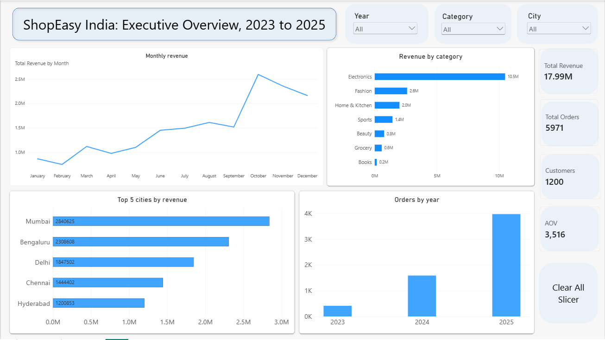
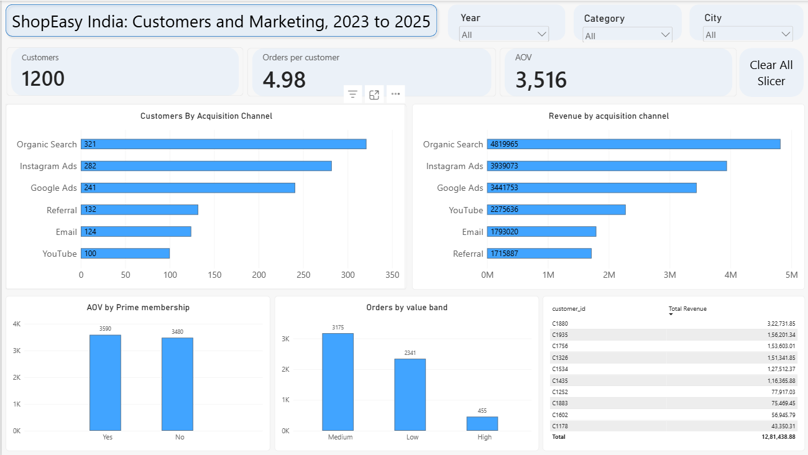
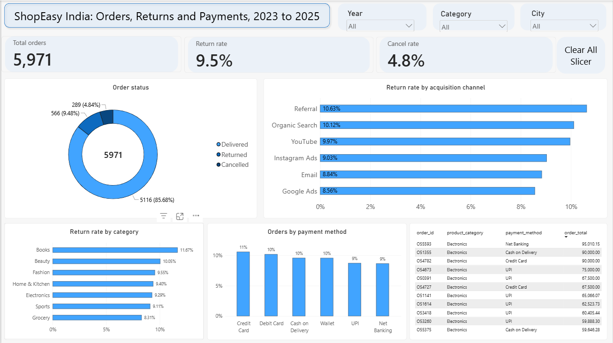

# ShopEasy India: Customer Behavior and Retention Analytics

End-to-end data analysis project: data cleaning in Python, business questions answered with SQL (PostgreSQL), and a 3-page Power BI dashboard, built for a simulated online retailer.

> **Note:** ShopEasy India is a fictional company and all data is synthetic. This is a portfolio project.

---

## Business Problem

ShopEasy India sells Electronics, Fashion, Home & Kitchen, Beauty, Grocery, Sports and Books in 14 Indian cities. Revenue is growing, but leadership cannot say which categories, cities and acquisition channels create value, or where returns and cancellations come from.

**Objective:** identify the highest-value categories, cities, channels and customers, and find out what drives returns and cancellations, so stakeholders can decide where to spend marketing and operations effort.

Full requirements are in [`docs/BRD.md`](docs/BRD.md).

## Tools Used

| Stage | Tool |
|---|---|
| Data cleaning | Python (pandas, numpy) in Google Colab |
| Storage and analysis | PostgreSQL (pgAdmin) |
| Dashboard | Power BI |
| Documentation | Markdown, BRD |

## Dataset

| Table | Rows (clean) | Description |
|---|---|---|
| `customers` | 1,200 | Customer profile: gender, age, city, state, signup date, acquisition channel, Prime membership |
| `orders` | 5,971 | Order details: category, price, quantity, discount, shipping, total, payment method, status, rating, delivery days |

Tables are joined on `customer_id`. Raw files are in `data/raw/`, cleaned files in `data/clean/`.

## Project Workflow

1. **Data cleaning (Python):** audited both tables, logged every issue and decision in `logs/cleaning_log.csv`.
2. **Database setup (PostgreSQL):** loaded the clean tables with a primary key and a foreign key from orders to customers.
3. **SQL analysis:** answered 20 business questions from basic aggregation to joins (`sql/analysis.sql`).
4. **Dashboard (Power BI):** three pages for overview, customers and marketing, and orders and returns.
5. **Documentation:** BRD, cleaning log and this README.

## Data Cleaning Highlights

The raw data contained realistic quality problems. Examples of what was found and fixed:

- Duplicate rows and duplicate order IDs
- Dates in three different formats, standardised to `YYYY-MM-DD`
- Inconsistent text (`upi` vs `UPI`, `Bangalore` vs `Bengaluru`, mixed case categories, trailing spaces)
- Missing values in price, quantity, discount and delivery days
- Invalid values (age 999, quantity -1)
- Unit price outliers (about 40 times too high), detected per category
- 30 orders linked to a customer ID that does not exist, removed
- Orders dated before the customer's signup date, flagged and handled

Missing and wrong values were **recovered using the order total formula** where possible:

```
order_total = unit_price x quantity x (1 - discount_pct / 100) + shipping_fee
```

This restored real values instead of dropping rows or guessing with averages. See `logs/cleaning_log.csv` for every decision, row count and reason.

## SQL Analysis

20 queries in [`sql/analysis.sql`](sql/analysis.sql), each with the business question as a comment:

- Totals, counts and distinct values
- Revenue, AOV and order counts by category, payment method, year and month
- Order value bands using `CASE WHEN`
- Revenue by city and acquisition channel using `JOIN`
- Prime vs non-Prime AOV
- Return rate per payment method using `FILTER`
- Customers who never ordered using `LEFT JOIN ... IS NULL`

Revenue is defined as the sum of `order_total` for **Delivered** orders only.

## Dashboard

| Page | Focus |
|---|---|
| Overview | Revenue, orders, customers, AOV, monthly trend, categories, top cities |
| Customers | Channel customers and revenue, Prime vs non-Prime AOV, order value bands, top customers |
| Returns | Order status, return rate by category, channel and payment method, high-value orders |





## Key Findings

- **Revenue:** about ₹1.80 crore from 5,116 Delivered orders; average order value is about ₹3,516.
- **Categories:** Electronics produces more than half of all revenue; Books and Grocery produce the least.
- **Cities:** Mumbai, Bengaluru and Delhi are the top three by revenue.
- **Seasonality:** monthly revenue peaks in October, consistent with a festive-season boost.
- **Channels:** Organic Search brings the most customers and revenue, but **YouTube customers are worth the most each** (about ₹22,800 per customer, against about ₹15,000 for Organic Search).
- **Prime members:** Prime AOV is about 3% higher than non-Prime (₹3,590 vs ₹3,480), so Prime membership makes only a small difference to order value.
- **Returns:** the overall return rate is 9.5% and the cancellation rate is 4.8%. Return rates are similar across categories (8.3% to 11.7%) and payment methods (8.7% to 10.6%), so no single factor clearly drives returns.

## Recommendations

1. **Test more investment in YouTube.** It has the smallest customer base but the highest revenue per customer; run a small budget increase and track results before scaling.
2. **Protect Electronics.** It carries most of the revenue, so stock, delivery and quality in this category matter most.
3. **Do not run a blanket return-reduction campaign.** Return rates are similar everywhere; start recording a return reason so the real cause can be found.
4. **Plan for the October peak.** Prepare inventory and marketing ahead of the festive season.

## Limitations

- The data is synthetic, so findings illustrate method, not real market behaviour.
- Order growth over the years partly reflects how the synthetic customer base was built and should not be read as real business growth.
- There is no cost or profit data, so margin analysis is not possible.
- Some groups are small (for example, 100 YouTube customers), so percentages for them should be treated with care.

## Repository Structure

```
ecommerce-customer-behavior-analysis/
  README.md
  docs/
    BRD.md
  data/
    raw/        customers_raw.csv, orders_raw.csv
    clean/      customers_clean.csv, orders_clean.csv
  notebooks/
    01_data_cleaning.ipynb
  sql/
    create_tables.sql
    analysis.sql
  dashboard/
    dashboard.pbix
    screenshots/
```

## How to Reproduce

1. Open `notebooks/01_data_cleaning.ipynb` in Google Colab, upload the two raw CSV files and run all cells.
2. In PostgreSQL, run `sql/create_tables.sql` and import the two clean CSV files.
3. Run `sql/analysis.sql` in pgAdmin.
4. Open `dashboard/dashboard.pbix` in Power BI Desktop and refresh the data source.

## What I Learned

- Cleaning messy data systematically and documenting each decision
- Using relationships between columns (the order total formula) to recover values
- Writing SQL joins, aggregations, conditional logic and reconciling results
- Checking dashboard numbers against SQL results before trusting them
- Reporting honestly when the data shows no strong pattern

## Author

**Chetan Chaure
BTech Computer Science student | Aspiring Data Analyst
LinkedIn: (https://www.linkedin.com/in/chetan-chaure-337225275/) | GitHub: https://github.com/chetanchaure07 | Email: chetanchaure05@gmail.com
